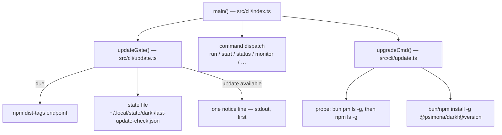

# CLI self-update — Design

## Need

darkf publishes to npm as `@psimona/darkf`, but installed copies never learn
about new releases. Updating means remembering `bun install -g @psimona/darkf`.
This feature adds a daily version check at CLI start and a `darkf upgrade`
command. The check is silent and bounded. The update itself stays explicit.
Users are the human operators of darkf and the agents they drive (REQ-1,
REQ-3, REQ-6, REQ-7).

## Success Criteria

- A `darkf` command on a machine with no check in the last 24 hours triggers
  exactly one registry request. A second command within 24 hours triggers
  none (REQ-1, REQ-2).
- When npm holds a newer version, every `darkf` command prints exactly one
  notice line as the first line of stdout. No registry request happens for
  that print (REQ-3, REQ-11, NFR-3).
- With the registry unreachable, a `darkf status` run behaves and exits like
  a run with no update feature, and prints nothing extra (REQ-4).
- `DARKF_NO_UPDATE_CHECK=1` produces zero registry requests and zero update
  output. It does not block an explicit `darkf upgrade` (REQ-5).
- `darkf upgrade` on the current version exits 0. On an older version it
  prints `upgrading a.b.c → x.y.z`, and the `darkf` binary runs the new
  version afterwards (REQ-6, REQ-7, REQ-8).
- With no package manager listing `@psimona/darkf`, `darkf upgrade` exits
  non-zero with a short reason and changes nothing (REQ-9).
- The check finishes or aborts within 2 seconds (NFR-1).

## Non-Functional Requirements

| NFR ID | Requirement Summary | Design Response | Verification Approach |
|--------|---------------------|-----------------|-----------------------|
| NFR-1 | Check finishes or abandons within 2 s | `AbortSignal.timeout(2000)` on the registry `fetch`. Probe-free gate path. | Unit test with a hanging `fetchImpl`. Assert the gate resolves. |
| NFR-2 | Zero new package dependencies | Only `fetch`, `Bun.semver`, `node:fs`, existing `Bun.spawnSync`. | `bun.lock` diff is empty. |
| NFR-3 | Notice is exactly one line before the output of the command | Gate prints at most one `console.log` line, always before dispatch. | Unit test captures stdout order. |

## Architecture

### High-Level Architecture



### Technology Stack

- **Runtime**: Bun >= 1.2 (`engines.bun`), TypeScript run directly.
- **Module**: one new file, `darkf/src/cli/update.ts`. One touched file,
  `darkf/src/cli/index.ts`. Core and engine stay untouched.
- **Patterns**: plain functions with injected dependencies. Exit codes via
  `process.exit`. Output via `console.log` / `console.error`, as the rest of
  the CLI does.

### Code Reuse from Existing Features

**Reused:**
- `Bun.spawnSync` arg-array pattern — `src/cli/index.ts:359` already spawns
  `git status` this way. The probe and the installer use the same shape.
- `Bun.which` — `doctorCmd` uses it to find agent binaries. The probe uses it
  to skip npm when absent.
- Exit-code conventions — `doctorCmd` and `statusCmd` return numbers into
  `process.exit`. `upgradeCmd` follows.
- Error-print style — one-line `console.error` messages, as in the run
  resolution errors at `src/cli/index.ts:116`.

**New (and why):**
- `src/cli/update.ts` — no existing module owns per-install state outside a
  repo, or registry access. The journal conventions in the engine are
  per-run and per-project (`.darkf/`), which NG-5 forbids for this feature.

## Runtime View

Entry 1 — every command except `upgrade`:

```text
main(cmd, rest)                                          [cli/index]
├─ updateGate(cmd, deps)                                 [cli/update]
│  ├─ readState(deps.stateFile)                          [cli/update]
│  ├─ isDue(state, deps.now())                           [cli/update]
│  ├─ ⇢ NETWORK fetch dist-tags (only when due, 2 s abort) [cli/update]
│  ├─ isNewer(installed, latest) — Bun.semver.order      [cli/update]
│  ├─ writeState(deps.stateFile, state)                  [cli/update]
│  └─ console.log(notice) — at most one line             [cli/update]
└─ dispatch: runCmd / startCmd / statusCmd / …           [cli/index]
```

Entry 2 — `darkf upgrade`:

```text
upgradeCmd(deps)                                         [cli/update]
├─ ⇢ NETWORK fetch dist-tags (always, loud on failure)   [cli/update]
├─ isNewer / already-latest verdict                      [cli/update]
├─ probeBun(): Bun.spawnSync("bun pm ls -g")             [cli/update]
├─ probeNpm(): Bun.spawnSync("npm ls -g --depth=0")      [cli/update]
├─ console.log("upgrading a.b.c → x.y.z")                [cli/update]
└─ Bun.spawnSync(pm, ["install", "-g", "@psimona/darkf@z.y.z"]) [cli/update]
```

The `⇢ NETWORK` lines are the only new I/O boundaries. Both cross from
`src/cli/update.ts` to the outside world. The wiring point is `main()` in
`src/cli/index.ts` (see Cross-Component Contracts).

## Components and Interfaces

### `src/cli/update.ts`

One module owns the whole feature. Functions take dependencies as
parameters, so tests inject a clock, a fetch, a spawner, and a temp state
file. No module-level mutable state.

```typescript
export interface UpdateState {
  lastCheck?: string;   // ISO timestamp of the last check attempt
  latestSeen?: string;  // newest version known to exist; drives the notice
}

export interface UpdateDeps {
  now(): number;                    // injectable clock
  fetchImpl: typeof fetch;          // injectable registry access
  spawnImpl: typeof Bun.spawnSync;  // injectable probes and installer
  stateFile: string;                // injectable state location
  installed: string;                // version from the package package.json
}

export function readState(file: string): UpdateState;
// Absent or corrupt file returns {}. Never throws.

export function writeState(file: string, state: UpdateState): void;
// mkdir -p on the parent; best-effort — swallow write errors (REQ-4).

export function isDue(state: UpdateState, now: number): boolean;
// True when lastCheck is missing, unparseable, or older than 24 h.

export function isNewer(installed: string, latest: string): boolean;
// Bun.semver.order(installed, latest) < 0.

export function checkRegistry(fetchImpl: typeof fetch): Promise<string | null>;
// GET https://registry.npmjs.org/-/package/@psimona%2Fdarkf/dist-tags
// with AbortSignal.timeout(2000). Returns `latest` when it is a
// semver-shaped string, else null. Never throws.

export async function updateGate(cmd: string | undefined, deps: UpdateDeps): Promise<void>;
// The startup path. See Key Algorithms.

export async function upgradeCmd(deps: UpdateDeps): Promise<number>;
// The `darkf upgrade` command. Returns the process exit code.
```

### `src/cli/index.ts` changes

- `main()` calls `updateGate(cmd, deps)` before dispatch, for every command
  except `upgrade`.
- `main()` gains the `upgrade` branch: `process.exit(await upgradeCmd(deps))`,
  matching the existing `doctor` branch shape.
- `main()` constructs `deps` once: real clock, real `fetch`, real
  `Bun.spawnSync`, default state file, installed version imported from
  `../../package.json` (Bun loads JSON imports natively).

### State file location

`stateFile()` resolves to the first existing candidate:

1. `$XDG_STATE_HOME/darkf/last-update-check.json`
2. `$HOME/.local/state/darkf/last-update-check.json`

Tests point it at a temp directory through `UpdateDeps`. No new public
environment variable exists (NG-4).

### Data Models

#### UpdateState — persisted at `~/.local/state/darkf/last-update-check.json`

```json
{ "lastCheck": "2026-10-30T08:00:00.000Z", "latestSeen": "0.4.0" }
```

#### Field Classification

| Field | Authored (stored) | Derived (recomputed) | Storage home |
|---|---|---|---|
| `lastCheck` | yes | no | state file key `lastCheck` |
| `latestSeen` | yes | no | state file key `latestSeen` |
| notice-active | no | yes | recomputed: `latestSeen` newer than installed version |
| due | no | yes | recomputed: `now - lastCheck >= 24 h` |

#### Data Lifecycle

Re-authoring only. The file holds two keys, rewritten in place. No delete
path exists. A user deleting the file loses nothing but one check cycle.

## Cross-Component Contracts

### Startup gate wires into command dispatch

- **Owner**: `updateGate()` / `upgradeCmd()` in `src/cli/update.ts`.
- **Consumer**: `main()` in `src/cli/index.ts`.
- **Propagation mechanism**: direct function import and call. `main()`
  constructs the deps object at the call site.
- **Wiring point**: `main()` in `src/cli/index.ts` — the gate call sits
  between `process.argv` parsing and the command `if`-chain, and the
  `upgrade` branch sits in that chain. Both sides are new or touched in this
  feature. If one side ships without the other, the feature is silently
  absent, so the tasks plan must pair them in one scope.

## Key Algorithms and Logic

### Startup gate (REQ-1..REQ-5, REQ-11)

1. If `cmd === "upgrade"`, return — upgrade fetches on its own, and the
   opt-out never blocks it.
2. If `DARKF_NO_UPDATE_CHECK` is non-empty, return at once. No state read,
   no request, no print (REQ-5).
3. Read the state file. Corrupt or absent counts as empty.
4. If `isDue()`, call `checkRegistry()`:
   - latest returned: set `latestSeen` when `isNewer(installed, latest)`
     holds, delete it otherwise.
   - null returned: leave `latestSeen` untouched.
   - either way: set `lastCheck` to now and write the file (stamp on
     attempt, REQ-2).
5. When the state carries `latestSeen` and `isNewer(installed, latestSeen)`
   holds, print the notice line:
   `darkf <latestSeen> available (installed <installed>) — run 'darkf upgrade'`.
   The print happens before dispatch, so it is the first line of stdout
   (NFR-3). A notice printed from the record needs no request (REQ-11).
6. Return. Dispatch proceeds.

The gate sends at most one registry request per invocation. `isDue()` bounds
that to one per 24 hours across invocations (REQ-1, REQ-2). A failed check
still stamps. A bad-network day costs one 2-second bound, not a retry per
command.

### Install-method probe (REQ-8, REQ-9)

1. Run `bun pm ls -g`. The `darkf` bin runs under bun by construction
   (`#!/usr/bin/env bun`), so bun is always present. Output containing
   `@psimona/darkf@` selects bun.
2. Otherwise, when `Bun.which("npm")` is non-null, run
   `npm ls -g --depth=0`. Output containing `@psimona/darkf@` selects npm.
3. Otherwise print
   `cannot determine how this darkf was installed — not managed by bun or npm`
   to stderr and exit 1 (REQ-9).

Each probe gets a 10 s timeout (design-originated, because no REQ covers
probe duration). It caps a hung package manager. A non-zero exit or a
timeout counts as "not managed by this manager", never as a crash. The
bun-first order means a `pack:local` snapshot resolves to bun. Upgrading
then replaces it with the npm release — accepted in the PRD (D-4).

### Upgrade (REQ-6, REQ-7, REQ-10)

1. Fetch dist-tags with the same `checkRegistry()`. Null → print the failure
   reason to stderr, exit 1 (REQ-10).
2. `order(installed, latest) >= 0` → print
   `darkf is current (installed <installed>)` and exit 0 (REQ-6). This also
   covers a locally installed snapshot newer than the published release —
   no downgrade.
3. Print `upgrading <installed> → <latest>` — the before/after line that
   REQ-7 requires.
4. Validate `latest` against `/^\d+\.\d+\.\d+(-[0-9A-Za-z.-]+)?$/` before
   any argv uses it (see Security Considerations).
5. Spawn the chosen manager with inherited stdio:
   `bun install -g @psimona/darkf@<latest>` or
   `npm install -g @psimona/darkf@<latest>`.
6. Exit with the installer code. On success also write the state file
   (`lastCheck` now, `latestSeen` deleted) so no stale notice survives.

### Version comparison

`Bun.semver.order(a, b)` returns -1, 0, or 1 like `strcmp`. "Update
available" is exactly `order(installed, latest) < 0`. Prerelease ordering
comes from Bun. darkf publishes plain `x.y.z` releases today (assumption
A-2).

## Testing Strategy

### Testing Approach

All logic lives in `update.ts` behind `UpdateDeps`, so every behavior is
testable without network or a real `~/.local/state`. Tests colocate as
`src/cli/update.test.ts` under `bun test`, like `detached.test.ts`.

**Coverage Areas:**
- Comparison and due-ness: `isNewer` (older, equal, newer, prerelease),
  `isDue` at the 24 h boundary, missing and corrupt state.
- `checkRegistry`: 200 with valid `latest`, non-200, malformed JSON,
  non-semver `latest`, hanging request — all return null, none throw.
- Gate: due day checks and stamps. A same-day re-run sends no request. A
  failed check still stamps and prints nothing. Opt-out returns before any
  state read, request, or print. The notice prints exactly one line before
  dispatch. A stale notice survives a failed check and clears when
  installed catches up.
- Upgrade: already-current exits 0. Probe refusal exits 1 and spawns no
  installer. The probe order selects bun before npm. Installer failure
  propagates its code. Success clears `latestSeen`.

### Testing Tools and Configuration

- **Framework**: `bun test`, colocated `*.test.ts` — repo convention.
- **Test doubles**: injected `now`, `fetchImpl`, `spawnImpl`. Temp state
  files via `node:fs/promises` + `mkdtemp`.
- **No network in tests**: `fetchImpl` is always a stub. One optional smoke
  test may spawn the real CLI with `XDG_STATE_HOME` pointed at a temp dir.
  It asserts only the no-notice behavior.

## Error Handling

### Startup check (all silent, REQ-4)

- **Fetch rejects / aborts / non-200 / bad JSON**: `checkRegistry()` returns
  null. The gate stamps and continues.
- **State file unreadable or corrupt**: `readState()` returns `{}`.
- **State file unwritable**: `writeState()` swallows. The next invocation
  re-checks.

### `darkf upgrade` (loud, REQ-9, REQ-10)

- **Registry failure**: one-line stderr reason, exit 1.
- **Unknown provenance**: one-line stderr reason, exit 1, no install.
- **Installer failure**: the output of the installer flows through
  inherited stdio. Its exit code passes through.

## Security Considerations

- **Trust boundary**: treat the npm registry response as untrusted input.
  `latest` must match a semver regex before any argv uses it. The argv is an
  array, never a shell string. Injection therefore needs a malformed version
  string that survives the regex first.
- **No outbound data**: the check is a GET with no body, no telemetry, no
  user identifiers.
- **No secrets**: the state file holds two version strings and a timestamp.
- **Installer provenance**: the design spawns only `bun` and `npm`, by bare
  name resolved through `PATH` — the same trust model as the existing `git`
  spawn in `src/cli/index.ts:359`.

## Assumptions and Dependencies

### Technical Assumptions

- `https://registry.npmjs.org/-/package/@psimona%2Fdarkf/dist-tags` returns
  `{"latest": "x.y.z", ...}` and is reachable from user machines (A-1).
- `Bun.semver` exists in every runtime darkf supports (`engines.bun >=1.2`)
  and orders everything darkf publishes (A-2).
- `$XDG_STATE_HOME` or `$HOME` is writable. If not, the feature degrades to
  silent no-ops per REQ-4 (A-3).

### External Dependencies

- **npm registry** — the only network endpoint. No SDK, no client library.

### Risk Mitigation

**Availability**
- Registry unreachable: silent no-op on the startup path. Loud one-line
  failure on the explicit upgrade path.

**Correctness**
- Corrupt state file: treated as empty. Worst case is one extra check.
- A `pack:local` snapshot upgraded over by the npm release: accepted and
  stated in the PRD (D-4). The upgrade prints both versions before it runs.

### Migration Strategy

No migration required. The state file appears on first check. No existing
data changes.
