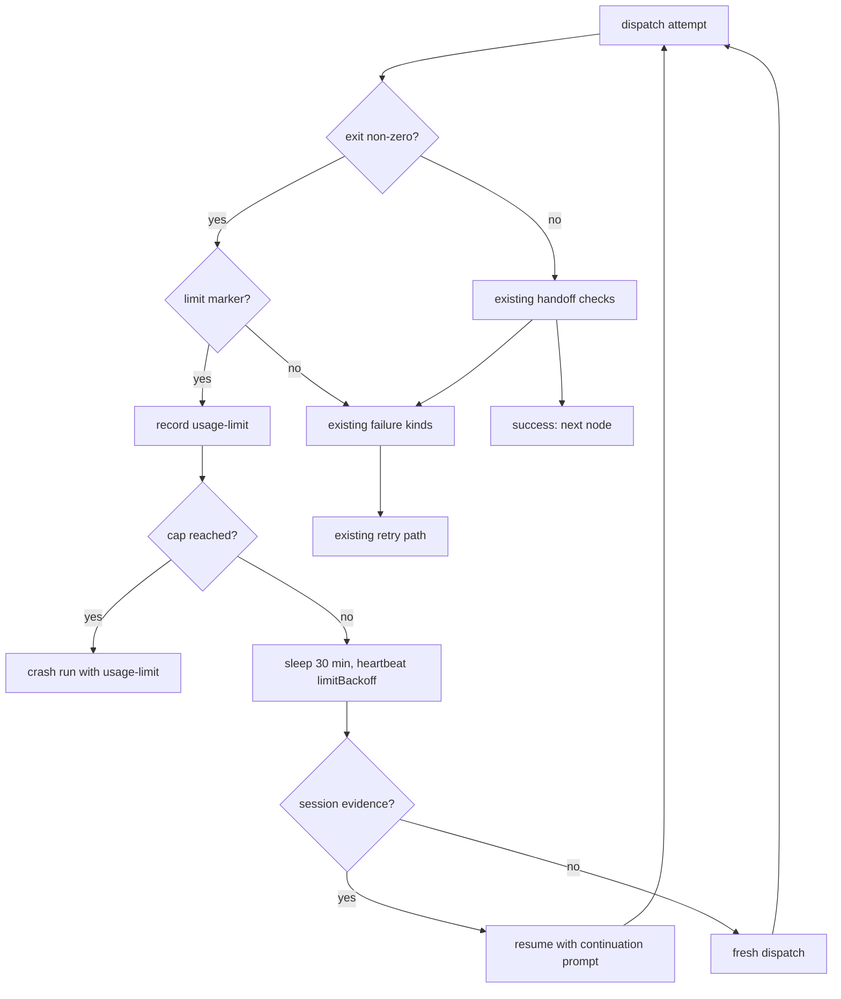

# Usage-limit backoff — Design

## Need

Unattended runs die at the first provider usage cap (REQ-1..REQ-5). The
dispatch fails with a generic runner crash, retries burn in seconds, and a
human restarts the run hours later. This design adds a named usage-limit
failure, a bounded wait that re-probes on a fixed interval, an in-session
resume that preserves pre-wall work, and a visible wait state in the CLI
tooling. Requirements live in `prd.md`. The design history lives in the
approved `spec.md` beside it.

## Success Criteria

- A dispatch that fails with a non-zero exit and a limit marker records
  `usage-limit`, and every other failure kind classifies exactly as before
  (REQ-1, NFR-2).
- A usage-limit failure waits 30 minutes, re-dispatches, and consumes no
  retry attempt (REQ-2, D-3).
- With persisted session evidence, the re-dispatch resumes the same
  session. Without it, the re-dispatch starts fresh (REQ-3, D-6).
- At the 24-hour cap the run crashes, and the journal carries the probe
  count, the total wait, and the provider message (REQ-4).
- `darkf status` and `darkf monitor` show the probe count and the next
  attempt time while a node waits (REQ-5).
- A still-limited re-probe costs no provider processing (NFR-1, D-5).

## Non-Functional Requirements

- NFR-1 — The re-probe is the continuation dispatch itself. While the
  limit holds, the provider rejects the request before processing, so the
  probe spends nothing. Design response: one short dispatch per interval,
  no separate health-check call (D-5).
- NFR-2 — The design leaves the non-limit path unchanged. Design
  response: the matcher
  runs only in the existing non-zero-exit branch. A no-match result
  takes the existing throw paths byte-for-byte.

## Architecture

### High-Level Architecture



Three layers change, one per concern:

- **darkf-core** owns the vocabulary: a new `CrashReason` kind, two new
  leaf-config fields, one new field on the running status (REQ-1, REQ-2,
  REQ-4, REQ-5).
- **darkf-engine** owns the wait: a new branch in the dispatch attempt
  loop (REQ-2, REQ-3, REQ-4).
- **darkf kit** (the opencode runner) owns classification and the
  continuation prompt (REQ-1, REQ-3).
- **darkf-cli** owns display: a `limitWarning` line in `status` and
  `monitor` (REQ-5).

### Technology Stack

- Bun + TypeScript, zero runtime dependencies (CON-3, CON-4).
- Timers: plain `setTimeout`/`setInterval` promises. No scheduler library.
- No new packages anywhere in the change.

### Code Reuse from Existing Features

- **Nudge pathway** (`docs/specs/_built/session-nudge`): the resume
  mechanism reuses the proven `-s` + short-message dispatch shape, the
  `agentSessionId` threading through `DispatchInfo`, and the
  `stepCount > 0` evidence guard from `scanStepFinish`. The continuation
  prompt mirrors `nudgeMessage`'s template shape (contract text + short
  instruction).
- **`readIncrementally` + `scanStepFinish`** (`agent-liveness`): the
  matcher reuses the line-splitting tolerance for non-JSON output. The
  evidence gate reuses the existing `stepCount` scan.
- **Warning precedent** (`stallWarning`, `nudgeWarning` in
  `darkf-cli/src/agents/status.ts`): `limitWarning` copies the one-line
  warn style and its fold pattern.
- New code: the marker matcher (one function, one marker list) and the
  wait branch in the engine. Nothing else is new.

## Runtime View

Entry point: the attempt loop in the engine, for one pass
(`darkf/src/engine/run.ts`). Buckets: ENGINE, KIT, CORE, CLI.

```text
run()                                          — engine/run.ts — ENGINE
├─ requireAgentRunner(...).run(...)            ⇢ KIT
│  └─ opencodeRunner.run                       — kit/agents/opencode.ts — KIT
│     ├─ matchUsageLimit(stderr, stdout)       — KIT (new, REQ-1)
│     ├─ scanStepFinish(stdout)                — KIT (existing evidence gate)
│     └─ throw AgentFailure(usage-limit)       ⇢ ENGINE
├─ catch AgentFailure                          — ENGINE
│  ├─ reason.kind === "usage-limit"?           — ENGINE (new branch, REQ-2)
│  ├─ emit running + limitBackoff heartbeats   ⇢ CORE (journal, REQ-5)
│  ├─ sleep usageLimitRetryMs                  — ENGINE
│  ├─ recompute attempt deadline               — ENGINE (D-7)
│  └─ runner.run(...) same attempt             ⇢ KIT
│     └─ continuation prompt + -s resume       — KIT (new, REQ-3)
├─ (cap reached) crashed(usage-limit)          — ENGINE ⇢ journal (REQ-4)
└─ status.ts fold + cli render                  — CLI reads limitBackoff (REQ-5)
```

## Components and Interfaces

### `darkf/src/core/types.ts` — vocabulary (REQ-1, REQ-2, REQ-4, REQ-5)

```ts
// CrashReason gains one kind:
| { kind: "usage-limit"; detail: string }

// BaseLeafDef gains two leaf-config fields, beside retries/timeoutMs:
usageLimitRetryMs?: number;   // default 30 * 60 * 1000
usageLimitMaxWaitMs?: number; // default 24 * 60 * 60 * 1000

// NodeStatus's running phase gains one optional field:
limitBackoff?: { probe: number; nextAttemptAt: number; waitedMs: number };
```

`usage-limit` stays out of `NUDGEABLE_KINDS` — the set already works by
explicit membership, so the set construction excludes the new kind.

### `darkf/src/engine/run.ts` — the wait branch (REQ-2, REQ-3, REQ-4)

In the `AgentFailure` catch of the attempt loop, a `usage-limit` reason
takes a new branch instead of `continue attemptLoop`:

- It does not advance the attempt counter and does not consume
  `def.retries` (D-3).
- It accumulates `waitedMs` per node visit. While
  `waitedMs + retryMs <= maxWaitMs`, it sleeps `retryMs`, emits
  `running` heartbeats carrying `limitBackoff` (probe index,
  `nextAttemptAt`, `waitedMs`), recomputes the attempt deadline (D-7),
  and re-dispatches the same attempt.
- At the cap it calls the existing `crashed()` path with the last
  `usage-limit` reason (REQ-4).
- The engine forwards `previousFailure` and `agentSessionId` to the next
  dispatch exactly as it does today — no new plumbing (the nudge path
  already threads both).

### `darkf/src/kit/agents/opencode.ts` — classification and resume (REQ-1, REQ-3)

```ts
export function matchUsageLimit(stderr: string, stdout: string): string | undefined
```

- Scans stderr and non-JSON stdout lines only. Agent-authored JSON lines
  never match, even when their text contains a marker.
- Markers (case-insensitive): `usage limit`, `rate limit`,
  `limit exceeded`, `429` — from the 2026-11-01 capture (D-4).
- Called only from the existing `exitCode !== 0` branch. On a match, the
  throw becomes `AgentFailure` with
  `crashReason: { kind: "usage-limit", detail }`. The session id stays
  evidence-gated (`stepCount > 0`) exactly as today. No match keeps the
  existing `runner-error` throw untouched.

The continuation path sits beside the nudge path in prompt building:

- Condition: `info.previousFailure?.kind === "usage-limit"` and
  `info.agentSessionId` present. A present session id *is* the
  evidence gate — the runner only ever attached it when `stepCount > 0`
  (D-6).
- Dispatch shape: `-s <agentSessionId>` plus a short continuation prompt:
  "a provider usage limit interrupted your previous turn. Continue
  where you left off." The prompt ends with the handoff contract text.
  The full fresh prompt is not replayed.
- Otherwise: the fresh prompt path, unchanged.

### `darkf-cli` status/monitor — display (REQ-5)

`darkf/src/kit/status.ts` gains `limitWarning`, folded from the
`limitBackoff` of the latest running status, printed in the existing
one-line warn style:

```text
warn: usage limit — probe 3/48, next attempt in 22m
```

The denominator is `ceil(maxWaitMs / retryMs)`. Both values come from the
leaf config recorded in the run. `monitor` re-renders it per tick, same
as `stallWarning`.

### Data Models

No persisted model changes. All new state lives in journal lines (JSONL,
written by `emit()` in the engine).

#### Field Classification

| Field | Kind | Storage home |
|---|---|---|
| `limitBackoff.probe` | authored | `journal.jsonl` running line, written by `emit()` on each post-wait heartbeat |
| `limitBackoff.nextAttemptAt` | authored | same line |
| `limitBackoff.waitedMs` | authored | same line |
| `usage-limit.detail` | authored | `journal.jsonl` crashed line, inside `reason` |
| "next attempt in Xm" | derived | computed by `status`/`monitor` from `nextAttemptAt` at read time |

#### Data Lifecycle

No delete path — lifecycle N/A. The journal is append-only. `.darkf/`
pruning already exists outside this change.

## Cross-Component Contracts

### Contract 1 — Failure shape: runner to engine

- **Owner**: `opencodeRunner` (KIT). **Consumer**: the attempt loop in
  the engine (ENGINE).
- **Propagation**: thrown `AgentFailure` with
  `crashReason: { kind: "usage-limit"; detail: string }` and an
  evidence-gated `agentSessionId`.
- **Wiring point**: the `AgentFailure` catch in `run()`'s attempt loop
  (`engine/run.ts`, the block that reads `err.crashReason`). The engine
  branch keys on `reason.kind === "usage-limit"` — nothing else.

### Contract 2 — Resume signal: engine to runner

- **Owner**: the engine (ENGINE). **Consumer**: `opencodeRunner` (KIT).
- **Propagation**: `DispatchInfo.previousFailure` (carrying
  `kind: "usage-limit"`) and `DispatchInfo.agentSessionId`, on the
  re-dispatch after a wait.
- **Wiring point**: the prompt-building block of `opencodeRunner.run`
  (`kit/agents/opencode.ts`, beside the `nudgeMessage` check). The
  runner resumes only when both fields are present. Either one absent
  means a fresh dispatch.

### Contract 3 — Wait visibility: engine to CLI

- **Owner**: `emit()` in the engine (ENGINE). **Consumer**: `status` and
  `monitor` folds (CLI).
- **Propagation**: `journal.jsonl` running lines carrying
  `limitBackoff`.
- **Wiring point**: the journal fold in `darkf/src/kit/status.ts` (the
  functions that already surface `stallWarning`/`nudgeWarning` to
  `status`/`monitor` in `darkf/src/cli/index.ts`) — the same fold gains
  the `limitBackoff` case.

## Key Algorithms and Logic

### Marker matcher (REQ-1, D-4)

Split stderr and stdout into lines. Skip lines that parse as JSON (those
are event objects. Agent-authored content lives there). Test each
remaining line, lowercased, against the marker list. Return the first
matched line as `detail`. The match runs only when `exitCode !== 0`. The
exit-0 + missing-handoff branch never consults it, so a limit-shaped
string there stays a `handoff-missing` on its existing repair path.

### Wait and resume loop (REQ-2, REQ-3, REQ-4, D-2, D-3, D-5, D-7)

Per node visit, once a `usage-limit` reason exists:

1. Compute `retryMs` and `maxWaitMs` from the leaf config, falling back
   to the defaults.
2. If `waitedMs >= maxWaitMs`, crash with the last `usage-limit` reason.
3. Otherwise sleep `retryMs`. During the sleep, emit `running`
   heartbeats with `limitBackoff` so the journal proves liveness and the
   CLI can show the countdown.
4. Recompute the attempt deadline from `timeoutMs`. The slept interval
   never eats the budget of the next dispatch.
5. Re-dispatch the same attempt. The runner resumes when the engine
   forwarded a session id. The continuation dispatch doubles as the
   limit probe (D-5). A still-limited provider rejects it, the matcher
   reclassifies `usage-limit`, and the loop returns to step 2.

No step in this loop touches `maxSteps`, cycle counters, or
`def.retries` — the cap is the only bound (D-3).

## Testing Strategy

- **Matcher fixtures** (REQ-1): the captured message with a non-zero
  exit classifies `usage-limit`. A non-limit API error stays
  `runner-error`. A limit string inside an agent-authored JSON line does
  not match. An exit-0 + missing-handoff output containing a limit
  string stays `handoff-missing`.
- **Engine wait loop** (REQ-2, REQ-4, D-3, D-7), extending
  `run.test.ts`: a stub runner throws `usage-limit`. The retry fires
  after the interval (shortened timer). `def.retries` is not consumed.
  The cap crashes with probe count, total wait, and detail. The engine
  recomputes the deadline after each wait.
- **Resume paths** (REQ-3): with a forwarded session id, the dispatch
  carries `-s` and the continuation prompt. Without it, the dispatch is
  fresh with the full prompt.
- **CLI display** (REQ-5): `limitWarning` renders from a journal with
  waiting heartbeats. A plain `running` heartbeat prints no warning.

## Error Handling

- **Cap exhaustion**: the run crashes through the existing `crashed()`
  path. The last lines of the journal carry the wait facts (REQ-4).
- **Still-limited probe**: the provider rejects the request. The matcher
  reclassifies, and the wait loop repeats. Costs no provider processing
  (NFR-1).
- **Continuation hangs**: covered by the existing per-attempt timeout and
  the agent-liveness stall warning. A timed-out continuation is a normal
  failed attempt, not a usage-limit failure.
- **Unrecognized non-zero exit**: existing `runner-error` handling,
  byte-for-byte (REQ-1, NFR-2).

## Security Considerations

No security-sensitive surface. The matcher reads the error output from
opencode. No auth, no secrets, no untrusted input, no network calls.

## Assumptions and Dependencies

### Technical Assumptions

- opencode terminates a limit-exhausted dispatch with a non-zero exit
  and the provider message in its output (observed 2026-11-01, CON-1).
- opencode persists the pre-wall session and `-s` resumes it (A-1) — the
  same mechanism the nudge path already relies on.

### External Dependencies

- The error text from the provider. Risk: a message reword could dodge
  the marker set. Mitigation: the journal records the raw output, so a
  miss crashes with facts in hand. Widening the marker list is a
  one-line change (A-2, cut-lines).

### Risk Mitigation

- False-positive classification would turn a real failure into a silent
  wait. Mitigation: markers match only non-JSON, non-agent lines on a
  non-zero exit, and the journal records every wait (REQ-5), so the
  supervisor can kill the worker at any moment (CON-2).
