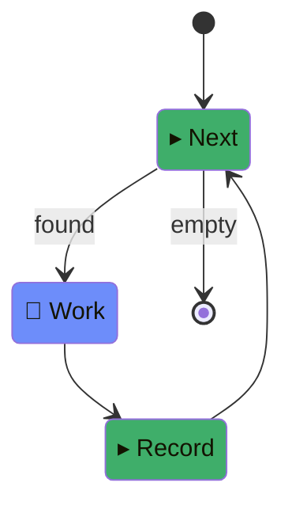

The quickstart's `haiku-commit` is two states that run once each. Most real
work isn't that — it's a list of things to do, worked one at a time until
the list is empty. This guide builds that shape as its own example,
`task-queue`, then watches a real run of it two ways: by hand with the CLI,
and by a small script that reacts to what the CLI only warns about.

If you haven't yet, read [Write your first workflow](../write-your-first-workflow/)
first — this guide assumes you already know what `on`/`next`, `retries`,
and a script's `(handoff, info)` signature mean.

## The pattern

A queue needs three states that keep looping until there's nothing left:

- **Next** — script. Picks the next pending item. Nothing left → exit.
  Found one → hand it to `Work`.
- **Work** — agent. Does the item.
- **Record** — script. Marks the item done, then loops back to `Next`.

the `article-classifier` example in `darkf/examples/` already has this exact shape,
but tracks its queue in plain module-scope variables — fine for one
blocking `darkf run`, since the whole run lives in one process. The moment
you want to `darkf start` a queue and check on it later from a *different*
process (which is the entire point of the next section), in-memory state
doesn't survive — the queue has to be a file. `task-queue` is that version:
the queue lives in `tasks.json`, in the target project's own directory, not
in memory.

## The example

```ts
// workflow.ts
import { EXIT, type WorkflowDef } from "@psimona/darkf/src/core/index.ts";
import { claudeCodeRunner } from "../../src/agents/claude-code.ts";

export const agentRunner = claudeCodeRunner;

export const workflow: WorkflowDef = {
  initial: "Next",
  states: {
    Next: {
      type: "script",
      file: "next.ts",
      on: { found: "Work", empty: EXIT },
    },
    Work: {
      type: "agent",
      prompt:
        'Do the task named in the handoff\'s "title" field: append one ' +
        "sentence to notes.md describing what you did, creating the file " +
        "if it doesn't exist yet. Don't overwrite what's already there.",
      next: "Record",
    },
    Record: {
      type: "script",
      file: "record.ts",
      next: "Next",
    },
  },
};
```

`next.ts` and `record.ts` are the only two places that touch `tasks.json`,
and they agree on one convention: `"in-progress"` means "the item `Next`
handed out, that `Record` hasn't closed out yet" — so a crash between the
two is visible as a stuck `in-progress` row, not a silently lost item.

```ts
// scripts/next.ts
import { readFileSync, writeFileSync } from "node:fs";
import { join } from "node:path";
import type { DispatchInfo, NodeResult } from "@psimona/darkf/src/core/index.ts";

interface Task {
  id: string;
  title: string;
  status: "pending" | "in-progress" | "done";
}

export default function next(_handoff: NodeResult, info: DispatchInfo): NodeResult {
  const path = join(info.rootDir, "tasks.json");
  const tasks: Task[] = JSON.parse(readFileSync(path, "utf8"));
  const task = tasks.find((t) => t.status === "pending");
  if (!task) return { event: "empty" };

  task.status = "in-progress";
  writeFileSync(path, JSON.stringify(tasks, null, 2));
  return { event: "found", output: { title: task.title } };
}
```

```ts
// scripts/record.ts
import { readFileSync, writeFileSync } from "node:fs";
import { join } from "node:path";
import type { DispatchInfo, NodeResult } from "@psimona/darkf/src/core/index.ts";

interface Task {
  id: string;
  title: string;
  status: "pending" | "in-progress" | "done";
}

export default function record(_handoff: NodeResult, info: DispatchInfo): NodeResult {
  const path = join(info.rootDir, "tasks.json");
  const tasks: Task[] = JSON.parse(readFileSync(path, "utf8"));
  const task = tasks.find((t) => t.status === "in-progress");
  if (!task) throw new Error("no in-progress task to record");

  task.status = "done";
  writeFileSync(path, JSON.stringify(tasks, null, 2));
  return { event: "recorded" };
}
```

`Work`'s own result is never consulted to decide whether the item is
done — same rule as the quickstart's `check.ts`. Only `Record`'s read of
`tasks.json` does. Nothing here bounds the loop with `maxCycles`: a
finite, file-backed queue already terminates on its own once every item is
`"done"`. A loop with no such ground truth (two agents going back and
forth, e.g. an implement/review cycle) is the case `maxCycles` exists for
instead — wrap that kind of loop in a composite, as the reference docs
on [core types](../../reference/core-types/) describe.

Render it:

```sh
bunx darkf render darkf/examples/task-queue
```

```
stateDiagram-v2
[*] --> Next
Next : ▸ Next
Next --> Work : found
Next --> [*] : empty
Work : 🤖 Work
Work --> Record
Record : ▸ Record
Record --> Next
classDef darkfAgent fill:#6d8dfa
classDef darkfScript fill:#3fae6a
class Work darkfAgent
class Next,Record darkfScript
```



## Run it

Same deal as the quickstart: a real agent dispatch per item, real cost.
Seed a queue with two items in a scratch git repo first:

```sh
mkdir my-project && cd my-project
git init
cat > tasks.json <<'EOF'
[
  { "id": "welcome", "title": "Write a one-sentence welcome note for new contributors", "status": "pending" },
  { "id": "changelog", "title": "Write a one-sentence changelog entry for today", "status": "pending" }
]
EOF
git add tasks.json && git commit -m "seed tasks"
```

`darkf doctor` is worth running first here — it checks the target is a git
repo, among other things, and a missing `tasks.json` or bad JSON in it
fails fast as a script crash rather than silently doing nothing:

```sh
bunx darkf doctor darkf/examples/task-queue
```

## Watch it manually

This is the part a single `darkf run` doesn't show: the point of
`darkf start` is that nothing is blocking, so you check in on your own
schedule.

```sh
bunx darkf start darkf/examples/task-queue
```

```json
{"runId":"49d35b19-c9c5-436c-8dbc-8cc737420c3b","pid":712518}
```

```sh
bunx darkf status --run 49d35b19-c9c5-436c-8dbc-8cc737420c3b
```

```
run: 49d35b19-c9c5-436c-8dbc-8cc737420c3b
root: /path/to/my-project
state: running
current node: Work (running)
visits: {"Next":1,"Work":1}
elapsed: 3.7s (node Work)
runtime: 1ms
```

Caught mid-`Work`: `Next` already ran once (found the first item), `Work`
is 3.7s into actually doing it. Tail it instead of polling by hand:

```sh
bunx darkf monitor --run 49d35b19-c9c5-436c-8dbc-8cc737420c3b --window 90
```

```
started with: {}
Work succeeded event=done (dwell 20079ms)
Record running attempt=1 (dwell 0ms)
Record succeeded event=recorded (dwell 1ms)
Next running attempt=1 (dwell 0ms)
Next succeeded event=found (dwell 0ms)
Work running attempt=1 (dwell 0ms)
Work succeeded event=done (dwell 17770ms)
Record running attempt=1 (dwell 0ms)
Record succeeded event=recorded (dwell 0ms)
Next running attempt=1 (dwell 0ms)
Next succeeded event=empty (dwell 0ms)
[*] succeeded event=empty (dwell 0ms)
succeeded
```

Two full `Next → Work → Record` laps, then `Next` finds nothing left and
the run exits. `tasks.json` and `notes.md` on disk now agree with that:

```json
[
  { "id": "welcome", "title": "Write a one-sentence welcome note for new contributors", "status": "done" },
  { "id": "changelog", "title": "Write a one-sentence changelog entry for today", "status": "done" }
]
```

```
Wrote a one-sentence welcome note for new contributors: "Welcome aboard — we're glad you're here, and we can't wait to see what you'll build with us!"

2026-10-13: Added a one-sentence changelog entry summarizing today's work.
```

```sh
bunx darkf report --run 49d35b19-c9c5-436c-8dbc-8cc737420c3b
```

```
run: 49d35b19-c9c5-436c-8dbc-8cc737420c3b
message: (none)
span: 37.9s, 7 dispatches
visits: {"Next":3,"Work":2,"Record":2}

dispatches:
  Next              0.0s  -> found
  Work             20.1s  -> done
  Record            0.0s  -> recorded
  Next              0.0s  -> found
  Work             17.8s  -> done
  Record            0.0s  -> recorded
  Next              0.0s  -> empty
usage (2 agent dispatches): $0.22, 369441 in (334480 cache-read, 34941 cache-write), 1724 out
```

Two items, two agent dispatches, $0.22. `status`'s `visits` counts distinct
states touched; `report`'s counts actual dispatches — that's why they
disagree (`{"Next":1,...}` mid-run vs. `{"Next":3,...}` after two full laps
plus the final empty check).

## The supervisor pattern

Everything above is a human doing the checking. darkf's own CLI output
already assumes something else might be doing it instead —
`status`/`monitor` describe a stalled heartbeat as "stall suspected ...
supervisor decides" and never act on it themselves. That something is
called a **supervisor**: whatever started the run and is now watching it,
ready to do something darkf itself won't — restart a worker that died
without a clean exit, escalate a real crash, keep polling a slow one.

A supervisor can be as small as a loop around the same three commands you
just ran by hand:

```ts
// examples/task-queue/supervise.ts
const WORKFLOW = new URL(".", import.meta.url).pathname;
const POLL_MS = 5_000;

async function darkf(...args: string[]): Promise<number> {
  const proc = Bun.spawn(["bunx", "darkf", ...args], { stdout: "inherit", stderr: "inherit" });
  return await proc.exited;
}

async function start(): Promise<string> {
  const proc = Bun.spawn(["bunx", "darkf", "start", WORKFLOW], {
    stdout: "pipe",
    stderr: "inherit",
  });
  const stdout = await new Response(proc.stdout).text();
  await proc.exited;
  return (JSON.parse(stdout) as { runId: string }).runId;
}

let runId = await start();
console.log(`started run ${runId}`);

for (;;) {
  const code = await darkf("monitor", "--run", runId, "--once");
  if (code === 0) {
    console.log("succeeded");
    await darkf("report", "--run", runId);
    break;
  }
  if (code === 1) {
    console.log("crashed — see report before deciding whether to resume");
    await darkf("report", "--run", runId);
    break;
  }
  if (code === 2) {
    console.log("orphaned — worker died without a terminal journal entry; restarting");
    runId = await start();
    continue;
  }
  // 6: still running. A real supervisor would check `darkf status --run`
  // here too, for the stall warning the plain exit code doesn't carry.
  await Bun.sleep(POLL_MS);
}
```

Run for real, against a queue with one item:

```
started run 6f0179e9-4c53-4498-8b51-4c59545d4cfd
started with: {}
still running
started with: {}
still running
started with: {}
still running
succeeded
succeeded
run: 6f0179e9-4c53-4498-8b51-4c59545d4cfd
message: (none)
span: 27.1s, 4 dispatches
visits: {"Next":2,"Work":1,"Record":1}

dispatches:
  Next              0.0s  -> found
  Work             27.1s  -> done
  Record            0.0s  -> recorded
  Next              0.0s  -> empty
usage (1 agent dispatches): $0.11, 186088 in (170902 cache-read, 15176 cache-write), 1219 out
```

(The two `succeeded` lines aren't a bug in the capture above — one is
`darkf monitor`'s own stdout, inherited straight through; the other is this
script's own `console.log` right after. A quieter version would capture
`monitor`'s output instead of inheriting it.)

This script has to exist as *something* calling `darkf start` from outside
— but that something doesn't have to be a hand-rolled loop. It can equally
be an agent harness itself, mid-session, deciding to kick off a workflow
and check on it between other turns. darkf already distinguishes that
case: `darkf start`/`run` check `process.env` for a short table of
"invoked from inside harness X" signals (`SUPERVISOR_ENV_SIGNALS` in
@psimona/darkf/src/kit/registry.ts` — today just `CLAUDE_CODE_SESSION_ID`) and, if
one matches, record which session is supervising the run. The OpenCode
plugin reads that back to show which session owns a run in its sidebar.
Nothing about the exit-code loop above changes because of it — the
difference is purely who's watching.

If you're packaging this as something a Claude Code agent reaches for
repeatedly rather than something a human runs once, this is the shape a
Claude Code **Skill** is for: the polling loop and its reactions become
the skill's instructions, and the agent supplies the judgment calls
(`darkf report` says the crash was a timeout — retry once? escalate?) that
this script's `if` statements hard-code instead.

## Next

[Test your workflow](../test-your-workflow/) covers exercising this same
`Next`/`Work`/`Record` routing without spending anything, by swapping in a
stub `agentRunner` for `Work`. [Journal](../../concepts/journal/)
explains exactly what `status`/`monitor`/`report` are reading to produce
everything shown above.
