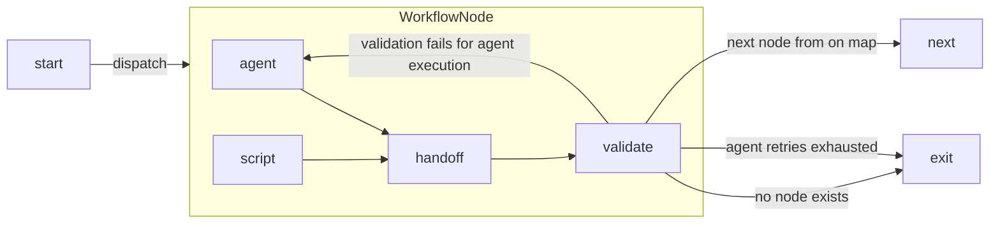
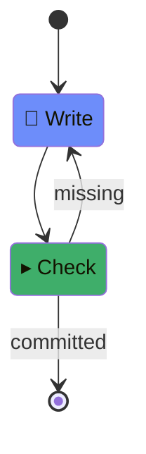

darkf ships a working example — `haiku-commit` — that uses a real agent
(Claude Code), not a stub. One cheap LLM call, so you see what an actual
run looks like instead of a canned demo. It's two states: an agent writes
a haiku into `README.md`, and a script checks it actually landed there
before committing.

## How a node works

Every node — agent or script — produces a **handoff**: a small JSON object
carrying the node's output and, optionally, an event naming what happened.

An agent gets a prompt describing the job and that schema; if its reply
doesn't comply, the engine retries before giving up.

A script is plain code — it must already return a compliant handoff,
since there's no prompt to retry against. Once the handoff validates, the
engine routes on its event to the next node, or exits if no node matches
or retries run out.



## The example

```ts
// workflow.ts
import { EXIT, type WorkflowDef } from "@psimona/darkf/src/core/index.ts";
import { claudeCodeRunner } from "../../src/agents/claude-code.ts";

export const agentRunner = claudeCodeRunner;

export const workflow: WorkflowDef = {
  initial: "Write",
  states: {
    Write: {
      type: "agent",
      prompt:
        "Add a haiku about darkf to README.md, wrapped in HTML comments " +
        "<!-- haiku:start --> and <!-- haiku:end --> on their own lines, " +
        "so an automated check can find it.",
      // Unconditional: Check decides what actually happened by reading the
      // file, not by trusting whatever event the agent reports.
      next: "Check",
    },
    Check: {
      type: "script",
      file: "check.ts",
      on: { committed: EXIT, missing: "Write" },
    },
  },
};
```

`check.ts` is plain code — no LLM involved in deciding whether the job is
actually done:

```ts
// scripts/check.ts
import { existsSync, readFileSync } from "node:fs";
import { join } from "node:path";
import type { DispatchInfo, NodeResult } from "@psimona/darkf/src/core/index.ts";

const START_MARKER = "<!-- haiku:start -->";
const END_MARKER = "<!-- haiku:end -->";

export default async function check(_handoff: NodeResult, info: DispatchInfo): Promise<NodeResult> {
  const readmePath = join(info.rootDir, "README.md");
  const text = existsSync(readmePath) ? readFileSync(readmePath, "utf8") : "";
  if (!text.includes(START_MARKER) || !text.includes(END_MARKER)) {
    return { event: "missing" };
  }

  const add = Bun.spawn(["git", "add", "README.md"], { cwd: info.rootDir });
  if ((await add.exited) !== 0) throw new Error("git add README.md failed");

  const commit = Bun.spawn(["git", "commit", "-m", "Add haiku to README"], {
    cwd: info.rootDir,
  });
  if ((await commit.exited) !== 0) throw new Error("git commit failed");

  return { event: "committed" };
}
```

Render it to see the shape before running anything:

```sh
bunx darkf render darkf/examples/haiku-commit
```

```
stateDiagram-v2
[*] --> Write
Write : 🤖 Write
Write --> Check
Check : ▸ Check
Check --> [*] : committed
Check --> Write : missing
classDef darkfAgent fill:#6d8dfa
classDef darkfScript fill:#3fae6a
class Write darkfAgent
class Check darkfScript
```

Rendered, that's:



## Run it

This makes one real `claude` call — real cost, typically around $0.10–$0.15
for a single haiku, not free. Needs the `claude` CLI installed and
authenticated. Run it from a scratch git repo with a `README.md`, not from
inside the darkf checkout itself (the agent's working directory follows
wherever you invoke `darkf` from):

```sh
mkdir my-project && cd my-project
git init
echo "# my-project" > README.md
git add README.md && git commit -m "initial"
bunx darkf run darkf/examples/haiku-commit
```

```
Write -> event=done
Check -> event=committed

status: succeeded
output: undefined
journal: .darkf/run/<runId>/journal.jsonl
```

:::note[A real bug, found writing this page]
`darkf run`'s printed `journal:` line is currently wrong — it's shown
relative to the workflow's own directory, not where you ran the command.
The actual file is always under *your* project's `.darkf/run/<runId>/`,
matching the path above. Not fixed yet; filed as a known issue.
:::

`README.md` now has a haiku, committed:

```
<!-- haiku:start -->
Hidden branch of code,
dark-f weaves through silent logs—
truth waits in the shade.
<!-- haiku:end -->
```

## The journal

Every run writes its journal to `.darkf/run/<runId>/journal.jsonl` — one
line per transition, JSON per line. This run's, in full:

```
{"runId":"...","state":"[*]","scopePath":[],"status":{"phase":"succeeded","result":{}},"timestamp":...}
{"runId":"...","state":"Write","scopePath":[],"status":{"phase":"running","attempt":1,...},"timestamp":...}
{"runId":"...","state":"Write","scopePath":[],"status":{"phase":"succeeded","result":{"event":"done","output":{...},"sessionId":"..."}},"timestamp":...}
{"runId":"...","state":"Check","scopePath":[],"status":{"phase":"running","attempt":1,...},"timestamp":...}
{"runId":"...","state":"Check","scopePath":[],"status":{"phase":"succeeded","result":{"event":"committed"}},"timestamp":...}
{"runId":"...","state":"[*]","scopePath":[],"status":{"phase":"succeeded","result":{"event":"committed"}},"timestamp":...}
```

Notice `Write`'s own result says `"event":"done"` — not `"committed"`.
That's the agent's self-report, and the workflow ignores it (`next`, not
`on`); only `Check`'s mechanical read of the file decides what happens
next. See [Journal](../../concepts/journal/) for what the begin/end
markers mean and why this file alone answers "did it finish, and how."

Inspect a finished run directly:

```sh
bunx darkf report --run <runId>
```

```
run: <runId>
message: (none)
span: 19.8s, 2 dispatches

dispatches:
  Write            19.8s  -> done
  Check             0.0s  -> committed
usage (1 agent dispatches): $0.13, 222581 in (201997 cache-read, 20572 cache-write), 1072 out
```

That's the real cost of the run above: one agent dispatch, $0.13, mostly
cache reads. See [CLI commands](../../reference/cli-commands/) for every
flag, and [Test your workflow](../../guides/test-your-workflow/) for how to
exercise this same routing logic without spending anything.

## See it in an editor

darkf also ships an OpenCode plugin — a live pane showing a run's status,
journal, and dwell warnings inside the editor while a workflow executes,
instead of needing a second terminal for `darkf monitor`.

<div style="border: 2px dashed var(--sl-color-gray-4); border-radius: 0.5rem; padding: 3rem 1.5rem; text-align: center; color: var(--sl-color-gray-3); margin: 1.5rem 0;">
  Screenshot coming soon — OpenCode plugin status pane
</div>

It's part of this repo (`darkf-opencode-plugin`), not yet published or
documented as its own install step.

Next, read [Node types](../../concepts/node-types/), then write your own in
[Write your first workflow](../../guides/write-your-first-workflow/).
